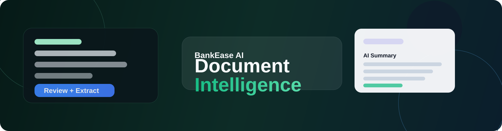
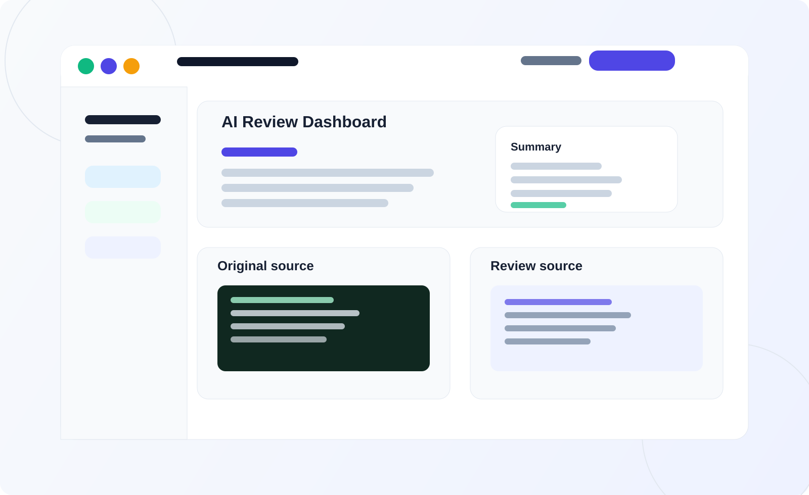

# BankEase AI

[](https://github.com/ritesh-rathod16/Bank_Ease_AI/stargazers)
[](https://github.com/ritesh-rathod16/Bank_Ease_AI/network/members)
[](LICENSE)
[](CONTRIBUTING.md)
[](CODE_OF_CONDUCT.md)
[](SECURITY.md)
[](https://nextjs.org/)
[](https://fastapi.tiangolo.com/)
[](https://www.python.org/)
[](https://ollama.com/)

BankEase AI turns complex financial documents into clear, reviewable, evidence-backed decisions for modern lending and underwriting workflows.

<p align="center">
  
</p>

<p align="center">
  
  
  
  
</p>

## Why contributors should care

This project sits at the intersection of practical AI, financial operations, and trustworthy automation. It is designed to help teams review dense documents faster without losing traceability or turning AI into a black box.

Contributors can improve:

- document extraction quality and field reliability
- stronger evidence-backed summaries
- UX for underwriting and review workflows
- local AI model fallback and deployment simplicity
- product workflows that handle real financial operations at scale

## Screenshot + metrics strip

<p align="center">
  
</p>

<div align="center">

| Metric | Value |
|---|---:|
| Document formats | PDF, DOCX, CSV, XLSX, scanned images |
| AI mode | Local-first with Ollama support |
| Review model | Evidence-first, source-backed summary |
| Primary use case | Lender / underwriter / document review workflows |

</div>

## Roadmap highlights

- Evidence-first extraction and review improvements
- Stronger local AI model fallback and lightweight deployment
- Better dashboard UX for reviewers and analysts
- More automated financial checks and flags
- Broader document coverage for statements, policies, and disclosures
- More trustworthy AI summaries for operations and underwriting teams

## Built for

- Fintech teams and lending ops
- Underwriting and risk review teams
- Document-heavy operations workflows
- Product teams building trustworthy AI review tools
- Local or private deployment environments

## Why this project matters

BankEase AI is a local-first financial document review platform for modern lending, underwriting, and document analysis workflows. Instead of forcing teams to rely on opaque black-box AI, the project focuses on evidence-backed extraction, PDF and document review, cited answers, and compliance-friendly summarization.

This matters because financial institutions, fintech teams, and operations teams need insights they can trust. BankEase AI helps turn dense financial documents into clear summaries, extracted fields, review findings, and AI-assisted analysis without forcing a paid API or GPU setup.

## Product highlights

- Evidence-backed document review for PDFs, DOCX, CSV, XLSX, and scanned financial documents
- AI summaries that keep the focus on the actual source document
- Local-first setup with lightweight Ollama model support and fallback options
- Reusable backend + frontend architecture for product teams and contributors
- Built for clarity, reviewability, and better financial decision support

Banking document intelligence with deterministic extraction and financial checks. No API key or GPU is required. Supported loan PDFs provide evidence-backed terms, clause review, cited extractive Q&A, and EMI calculations. DOCX files support bounded text extraction and Q&A cited by extracted section; Word pagination and structured financial fields are not inferred. Insurance policy schedules and certificates extract a limited set of explicitly labeled fields and clause passages; the app does not verify active coverage or claim eligibility. OCR uses PyMuPDF's Tesseract integration when a system Tesseract installation and matching language data are available. Supported bank statement CSV/XLSX files, selectable-text PDF tables, and recognized table layouts on fully scanned PDFs/images support transaction review, balance reconciliation, and duplicate candidates. XLSX statements retain worksheet and source-row evidence. OCR-derived statements remain marked for human review. Missing or uncertain values are not silently guessed.

## Product preview

<p align="center">
  
</p>

## Built for real financial review workflows

BankEase AI is designed for teams who need faster document review without losing trust, traceability, or evidence. The product is shaped around financial operations: upload, extract, review, question, and summarize the document with clear source-backed reasoning.

### Feature matrix

| Capability | What it does | Why teams care |
|---|---|---|
| Multi-format ingestion | Accepts PDFs, DOCX, CSV, XLSX, and scanned document images | Reduces friction in real-world financial operations |
| Evidence-first extraction | Pulls key clauses, dates, rates, fees, and obligations from the original source | Keeps review grounded in the document rather than generic AI hallucination |
| AI summaries | Produces plain-language summaries in the review flow | Makes dense finance docs easier for teams and customers to understand |
| Local-first AI | Runs with lightweight Ollama models and fallback support | Keeps setup simple and cost-efficient for local/private environments |
| Cited Q&A | Answers questions with document-backed context | Improves trust and auditability |
| Review workflow | Supports structured review findings and document-level analysis | Fits underwriting, operations, and compliance processes |

### Demo / walkthrough layout

<p align="center">
  <a href="docs/assets/dashboard-preview.svg">
    
  </a>
  <a href="docs/assets/github-banner.svg">
    
  </a>
</p>

> A demo GIF or short product walkthrough can be dropped here for a more polished GitHub launch experience.

## Join the project

BankEase AI is built for contributors who care about real-world AI, fintech workflows, and high-trust software. Whether you are improving document intelligence, sharpening the UX, or making the local AI stack easier to deploy, your contribution can move the project forward.

- Star the repo to support the project
- Open an issue for a product improvement or bug
- Contribute a fix, UI enhancement, or AI pipeline improvement
- Share feedback on local setup, UX, or review quality

## Community and project health

- [License](LICENSE)
- [Code of Conduct](CODE_OF_CONDUCT.md)
- [Contributing Guide](CONTRIBUTING.md)
- [Security Policy](SECURITY.md)
- [Documentation hub](docs/README.md)
- [Issue templates](.github/ISSUE_TEMPLATE)
- [Pull request template](.github/PULL_REQUEST_TEMPLATE.md)
- [Changelog](CHANGELOG.md)

## Windows setup (Ollama + local AI + app requirements)

Install the required tools first:

- Python 3.11+ (or 3.10+ if needed by your environment)
- Node.js LTS 20+
- Git
- Ollama for Windows

### 1) Install Ollama
You can install it from the official Windows installer or with winget:

```powershell
winget install --id=Ollama.Ollama -e
```

Then open a new terminal and start the Ollama service:

```powershell
ollama serve
```

### 2) Download the recommended local models
This project is configured for local-first AI and expects the model to be downloaded separately. The default lightweight setup is:

```powershell
ollama pull qwen3:1.7b
ollama pull qwen3:0.6b
ollama pull llama3.2:1b-instruct
```

If you want a single main model only:

```powershell
ollama pull qwen3:1.7b
```

### 3) Create your local environment file
Copy the example env file:

```powershell
Copy-Item .env.example .env
```

Then make sure your `.env` contains the local AI settings:

```env
AI_PROVIDER=local
OLLAMA_BASE_URL=http://127.0.0.1:11434
OLLAMA_MODEL=qwen3:1.7b
OLLAMA_FALLBACK_MODELS=qwen3:0.6b,llama3.2:1b-instruct
```

### 4) Install project dependencies
From the repo root:

```powershell
npm install
python -m pip install --upgrade pip
python -m pip install -r requirements.txt
```

### 5) Run the app
```powershell
npm run dev:all
```

This starts the FastAPI backend on `http://localhost:8000` and the Next.js frontend on `http://localhost:3000`.

## Quick start
```bash
npm install
python -m pip install -r requirements.txt
npm run dev:all   # FastAPI on :8000 and Next.js on :3000
```
Open `http://localhost:3000` for the Next.js App Router UI and `http://localhost:8000/docs` for FastAPI API documentation. Next.js rewrites API requests to the backend so browser authentication cookies remain same-origin. Set `BANKEASE_API_ORIGIN` if the API is not at `http://127.0.0.1:8000`.

Uploads return immediately with a processing status. A durable background worker extracts text, runs optional OCR, and updates the saved analysis; the document page polls status and offers retry after a failed job. The worker starts with the API by default. Set `BANKEASE_ENABLE_DOCUMENT_WORKER=false` to run the API without a worker, or `BANKEASE_ASYNC_DOCUMENTS=false` to use synchronous uploads during local debugging.

| Command | What it does |
|---|---|
| `make check` | Preflight: Python 3.10+, backend dependencies, app imports, Next.js files, dataset checksums, writable storage, API port free |
| `npm run dev` | Run the Next.js frontend (the backend must already be running) |
| `npm run dev:api` | Run the FastAPI API only |
| `npm run dev:all` / `make dev` | Run FastAPI and Next.js together |
| `make test` | Preflight then the full backend suite |
| `make data` | Regenerate synthetic dataset and manifests |
| `make clean` | Remove caches and local runtime records |
| `make venv` | Create `.venv` (then `. .venv/bin/activate && make install`) |

Windows PowerShell: run `npm.cmd install`, then `python -m pip install -r requirements.txt`, then `npm.cmd run dev:all` if PowerShell blocks the `npm.ps1` shim. Scanned-document OCR needs Tesseract OCR installed on the API host and its `eng` language data (or set `BANKEASE_OCR_LANGUAGE` and `TESSDATA_PREFIX`). OCR defaults to 10 scanned pages, 15 seconds per page, and 45 seconds per document. Scanned statement extraction requires a recognized header and column layout; OCR results remain `needs_review`, and mixed selectable-text/scanned pages are not combined automatically. `PORT` configures the API (default 8000); the frontend uses port 3000. Other environment variables: `BANKEASE_API_ORIGIN`, `MAX_UPLOAD_MB` (10), `MAX_PDF_PAGES` (100), `BANKEASE_RETENTION_HOURS` (24; `0` disables purge), `BANKEASE_RETENTION_SWEEP_SECONDS` (900), `BANKEASE_DATA` (storage dir, default `data/runtime`), `CORS_ORIGINS`, `APP_ENV`, and `BANKEASE_STORAGE_BACKEND`. See `.env.example`; it is not auto-loaded.

## Synthetic datasets (`data/samples/`, all fictional; see `docs/DATASET.md`)
| Folder | Files | Purpose |
|---|---|---|
| `personal/` | 4 | fixed/floating, flat fee, **EMI mismatch**, **missing fee** |
| `home/` | 2 | floating (benchmark-linked), fixed with foreclosure charge, mortgage + insurance |
| `vehicle/` | 2 | down payment, hypothecation, default, repossession |
| `sanction_schedule/` | 3 | sanction letters (personal, home), 36-row repayment schedule |
| `comparison_edge/` | 13 | baseline vs rate/fee changes, identical copy, missing fields, conflicting values, ambiguous terms, prompt injection, partially scanned, fully scanned (rejected), malformed, wrong type, empty |
Machine-readable: `data/samples/manifest.json` (expected terms/pages/clauses/Q&A/EMI/comparisons + sha256) and `manifest.csv`.

## Manual upload test
Start both processes with `npm run dev:all`, register a local account, follow the development verification link, then upload a PDF, DOCX, PNG/JPEG/TIFF scan, supported bank statement CSV, or XLSX statement in Documents. Review extracted terms or transaction rows, examine page/section evidence and reconciliation signals, ask evidence-grounded questions about supported documents and statement rows, calculate EMI, compare stored loan offers, and open reports. The API enforces account sessions and CSRF, so unauthenticated direct upload requests are rejected.

The dashboard presents owner-scoped analysis counts, recent uploads, evidence search, loan repayment calculations, review findings, and a cited document assistant in a responsive white-and-blue layout. Assistant conversations are owner-scoped and can retrieve page evidence from supported loan, insurance, financial-statement, and audit-report documents or transaction-row evidence from bank statements. Loan dates and policy expiry candidates retain page evidence; the owner must confirm a date in the document view before it appears in upcoming obligations. Ambiguous numeric dates need manual review, and recurring payment dates are not inferred. See `docs/IMPLEMENTATION_STATUS.md` for dashboard, storage, model, and verification limits.

## Storage and deletion (sensitive documents)
- Accepted PDF, scanned-image, DOCX, CSV, and XLSX originals are stored under generated names in private `data/runtime/uploads`, outside the frontend. Authenticated previews/downloads check the owning account; document/account deletion removes the source file.
- Source files and extracted records are not encrypted at rest. The document worker runs a bounded retention sweep every 15 minutes by default and uploads also trigger an owner-scoped sweep. Expired source files and derived records are deleted. Configure `BANKEASE_RETENTION_HOURS=0` to disable expiration; the worker must be enabled for scheduled sweeps.
- Rejected uploads are not retained. Do not use this local prototype with real customer financial documents.
- By default, account records and per-document analysis records (including extracted text) are JSON files in `data/runtime/`; restrictive POSIX modes are requested. **Not encrypted at rest.**
- For local MongoDB development, set `BANKEASE_STORAGE_BACKEND=mongodb`, `MONGODB_URI`, and optionally `MONGODB_DATABASE`. The app creates indexes on startup and stores page text in owner-scoped `document_chunks`.
- `DELETE /documents/{id}` removes it; records older than `BANKEASE_RETENTION_HOURS` are removed by the scheduled worker and on upload.

## Status
Implemented: PDF classification, evidence-backed loan term extraction, clause categories with neutral attention points, owner-scoped loan field corrections, revisioned owner corrections for statement rows, EMI checks, extractive document Q&A, private original previews, linked document revisions with evidence-bearing version comparisons, and loan/statement comparison screens with owner-scoped saved snapshots/history and PDF exports. Statement import supports CSV, recognized selectable-text PDF tables, and OCR tables with recognized headers on fully scanned PDFs. All statement paths support paginated rows, search, inclusive date filters, balance reconciliation, exact statement comparison using saved effective corrections, and possible duplicate review signals. OCR-derived statement cells retain page, row evidence and coordinates but remain `needs_review`; mixed-layout PDFs and unrecognized tables need human review. Source transactions and evidence are retained; account exports include transaction correction history. Ambiguous, qualified, and conflicting values are marked for review.
MongoDB configuration, startup/shutdown, indexes, owner-scoped accounts/documents, secure local sessions, and account workflows are implemented for development. Production startup remains intentionally blocked while email delivery, encryption and host ACLs for private local files, distributed rate limits, deployment controls, and live MongoDB operations remain unverified.
**Not implemented:** a production-trained model, embeddings, mixed-layout statement table extraction, approved public training data (none downloaded), production email, and production deployment. A separate GPT-2 LoRA experiment was run on synthetic documents; it scored below the deterministic classifier and is not connected to product inference. See [ML training](docs/ML_TRAINING.md) and [implementation status](docs/IMPLEMENTATION_STATUS.md).
Informational use only; not legal or financial advice.
